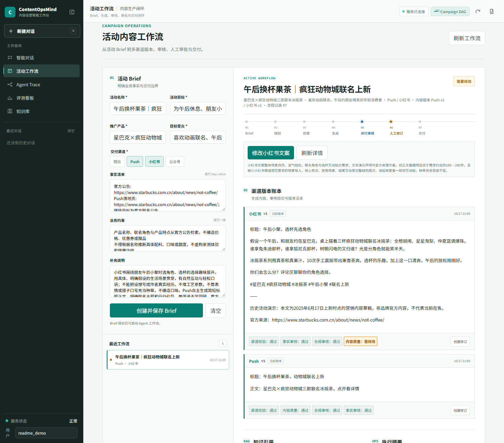
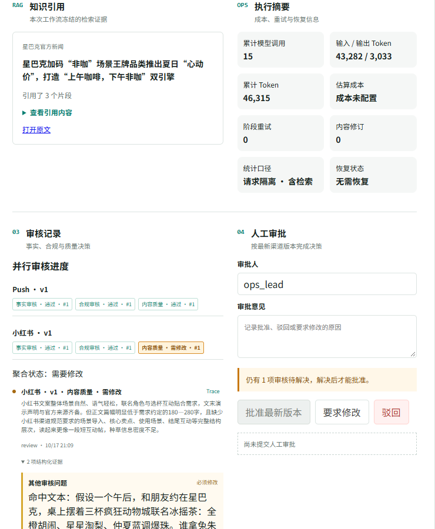
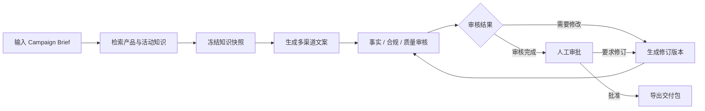

# ContentOpsMind

### 多 Agent 内容生产与合规审核工作台

面向品牌营销内容的生产与审核场景，将 Campaign Brief、品牌知识、多渠道文案、事实核验和人工审批组织为统一工作流。系统为每次任务保留知识依据、内容版本和审核记录，帮助运营人员完成从需求输入到内容交付的全过程。

**核心链路：Brief 解析 → 知识检索 → 多渠道生成 → 事实与合规审核 → 修订 → 人工审批 → 交付包导出。**

## 界面预览

以星巴克 × 疯狂动物城联名冰摇茶为例，从场景、受众和表达要求出发，检索官方公告并自主生成 Push 与小红书种草内容。

> 基于 2025 年 6 月官方公告，模拟上新时点的营销内容生成。非品牌官方内容，不代表当前在售或现行优惠。

### 活动工作台

围绕“午后换杯果茶”设定受众、渠道风格与事实边界，不预填标题或成稿；产品信息由知识库检索，分别生成简短 Push 与场景化小红书文案。



### 知识引用与审核审批

追溯官方公告来源，查看事实、合规及内容质量审核结果；人工审批独立于模型审核，内容未经批准不可交付。



## 应用场景

| 场景     | 业务需求                                           | 系统能力                                                               |
| -------- | -------------------------------------------------- | ---------------------------------------------------------------------- |
| 新品推广 | 同一组产品信息需要适配多个渠道                     | 基于产品资料生成小红书、微信公众号、短信等渠道内容，统一事实与品牌表达 |
| 营销活动 | 优惠门槛、商品范围、活动期限容易在文案中遗漏或误用 | 检索活动规则并冻结知识快照，对价格、权益及适用条件进行校验             |
| 内容审校 | 生成结果需要明确问题、证据和处理方式               | 并行执行事实、合规与质量审核，输出结构化风险及修订依据                 |
| 审批交付 | 内容修改后需要重新确认，任务失败后需要继续执行     | 管理修订版本与审批状态，复用已完成结果，经人工批准后导出交付包         |

## 业务流程



工作台集中展示任务状态、渠道文案、检索依据、审核问题及版本变化。内容交付以当前版本的完整审核与人工批准为前提。

## 核心能力

### 多 Agent 协作

根据任务主辅意图编排 Copywriting、Compliance、RuleCheck 和 Style Agent，完成内容生成、品牌风格适配、事实规则核验与风险识别。业务 Skill 将品牌规范、活动规则、渠道模板和审核输出契约独立管理，便于调整和扩展。

### 知识驱动的内容生成

通过语料、品牌、活动和文档状态过滤控制检索范围，并结合版本优选与知识快照，使生成和审核使用可追溯的资料依据。正式检索链路支持查询改写、关键词与向量双路召回、RRF 融合及 LLM 重排，并保留原加权策略作为可配置选项。

### 可追踪的审核与审批

审核输出关联风险类型、证据及处理建议。结构化事实校验和审批状态机共同约束交付，避免审核缺失、版本失配或未经批准的内容进入交付环节。

### 可恢复的任务执行

通过 Redis 执行锁、幂等控制与乐观并发保护工作流状态，结合阶段超时、失败恢复和结果复用，减少重复执行。Trace 与 Prometheus 记录阶段耗时、模型用量、重试及执行结果，支持问题定位。

## 技术架构

| 层次              | 主要组件                                          |
| ----------------- | ------------------------------------------------- |
| 工作台与接口      | Web 工作台、FastAPI、OpenAPI                      |
| 任务与 Agent 编排 | Campaign Workflow、Agent Orchestrator、业务 Skill |
| 知识与记忆        | ChromaDB、关键词/向量检索、分层会话记忆           |
| 执行与状态管理    | Redis、执行锁、版本控制、审批状态机               |
| 模型与可观测性    | 统一 LLM Gateway、Trace、Prometheus               |
| 部署与验证        | Docker Compose、离线单元测试、检索评测            |

模型通过 Anthropic Messages 兼容接口接入；支持配置自定义服务端点和模型名称。网页默认检索、聊天知识上下文及活动工作流共用 RRF 增强知识工具；通过 `RAG_FUSION_STRATEGY=weighted` 可切回原加权策略。

## 效果验证

基于 **33 份官方原始网页、106 个文档片段和 107 条人工审核参考标签的正向检索样本**，对比不同检索链路：

| 检索方案                                           | 证据 Hit@1 |     MRR@5 |
| -------------------------------------------------- | ---------: | --------: |
| 关键词/向量混合检索                                |      46.7% |     0.557 |
| Query Rewrite + 混合召回 + LLM Rerank              |      72.0% |     0.754 |
| Query Rewrite + 关键词/向量召回 + RRF + LLM Rerank |  **83.2%** | **0.860** |

增强链路将首位证据命中率由 **46.7% 提升至 83.2%**。以上指标衡量冻结数据集上的检索效果，属于非盲测的项目内对比实验，不代表生成准确率。RRF 组候选预算更大，提升对应整条链路配置变化。完整原始资料与人工标注不随仓库分发。

## 快速开始

准备 Docker Compose，并将 `.env.example` 复制为 `.env`，配置以下参数：

| 参数                  | 说明                                     |
| --------------------- | ---------------------------------------- |
| `ANTHROPIC_API_KEY`   | 模型服务凭据                             |
| `ANTHROPIC_MODEL`     | 服务支持的模型名称                       |
| `ANTHROPIC_BASE_URL`  | 可选，自定义 Anthropic Messages 兼容端点 |
| `REDIS_PASSWORD`      | 独立随机密码，建议使用十六进制字符串     |
| `RAG_FUSION_STRATEGY` | `rrf`（默认）或 `weighted`               |

```bash
docker compose up --build -d
```

- 工作台：<http://127.0.0.1:8020/app/>
- API 文档：<http://127.0.0.1:8020/docs>
- 可选监控：执行 `docker compose --profile monitoring up -d` 后访问 <http://127.0.0.1:9093>。

首次构建需要下载依赖和 Embedding 模型；真实模型调用按服务商规则计费。当前部署配置面向本地演示，公网部署前需要补充认证、授权与访问控制。

## 体验一个完整任务

仓库提供虚构品牌“澄光生活”的合成产品与活动资料，可从工作台的“活动工作流”入口体验：

1. 填写便携咖啡杯等演示商品信息、推广目标、目标人群及活动约束。
2. 选择小红书与短信等渠道，执行知识检索和文案生成。
3. 查看知识快照及事实、合规、质量审核结果。
4. 针对问题创建修订版本，确认后完成人工审批。
5. 导出包含内容与审核依据的交付包。

演示数据不代表真实品牌信息。真实品牌资料需自行准备并审核；本仓库不分发官方原文、完整评测标签或真实用户数据。

## 项目结构

```text
agents/              多 Agent 编排
api/                 FastAPI 接口
campaign_workflow/   任务执行、修订与审批
core/                模型网关、规则、Skill 与 Trace
mcp/                 混合检索与工具管理
memory/              分层会话记忆
monitor/             运行指标与监控
skills/              品牌、活动、渠道及合规规则
web/                 工作台界面
evaluation/          应用内质量评估
data/rag_docs/       合成品牌资料与编辑规范
```

## 使用范围

本项目为可本地运行的应用原型，合规审核用于辅助审校，最终决策由人工完成。第三方品牌、商标和资料的权利归各自权利人所有；截图中的文案为历史活动演示，非品牌官方内容，不代表当前在售或发布授权。仓库未指定开源许可证。

密钥仅在本地 `.env` 中配置，不要提交环境文件、真实用户对话、客户资料或模型原始日志。默认部署仅绑定本机地址，公网部署需补充认证、授权和租户隔离。
